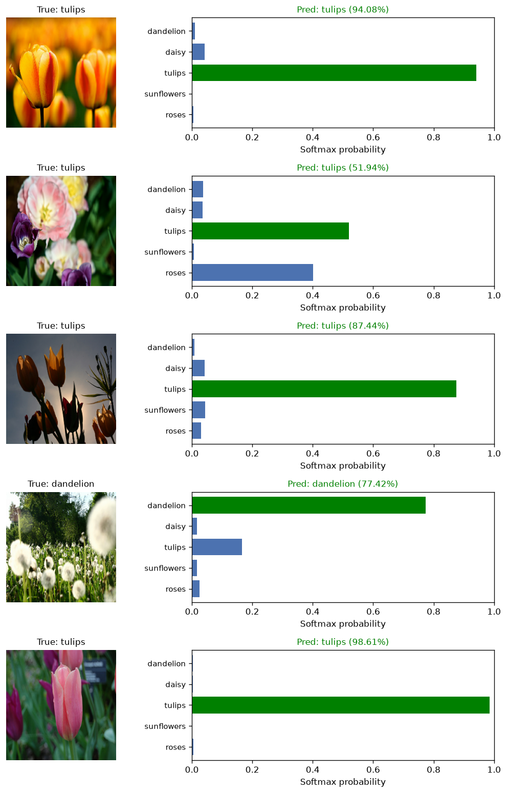
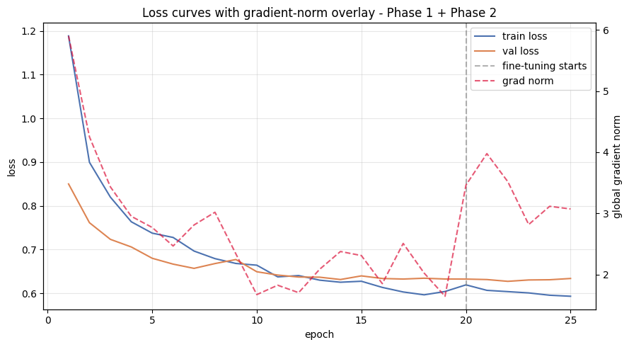
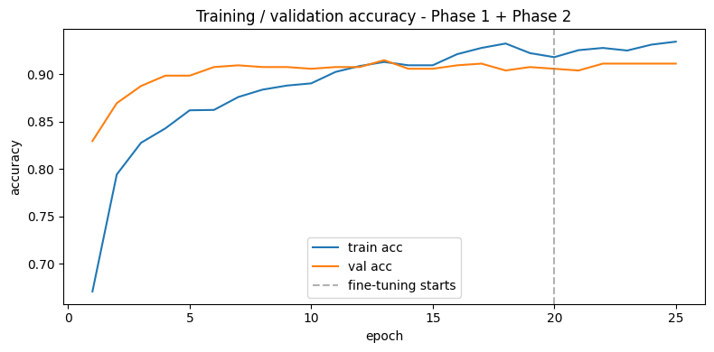
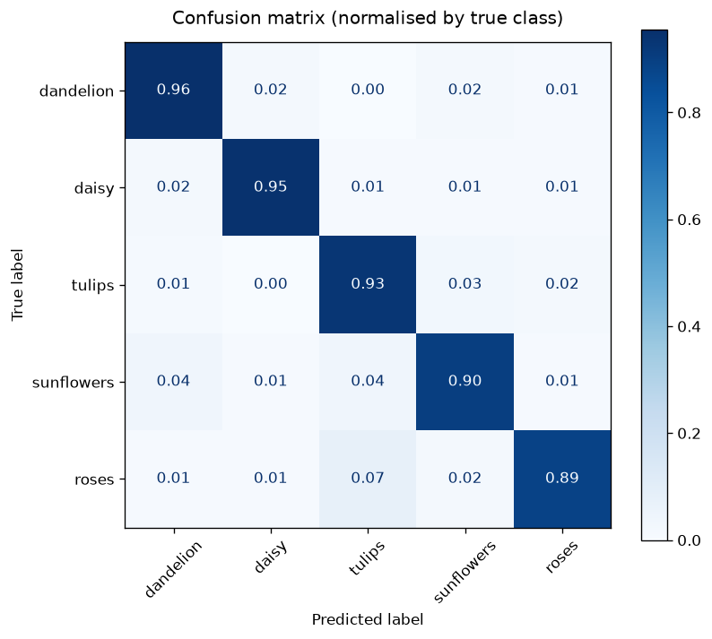
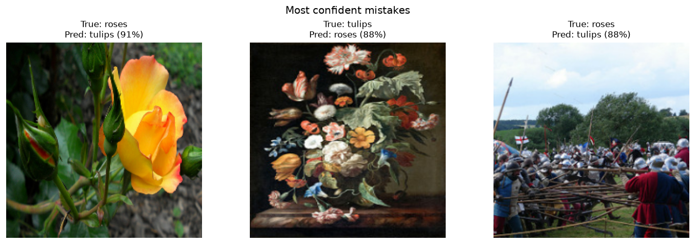

# 🌸 FloraVision

**Flower recognition with a fine-tuned ResNet-50**

Recognises daisies, dandelions, roses, sunflowers and tulips from a single photo.

    

## Overview

FloraVision takes an ImageNet-pretrained ResNet-50 and adapts it to five flower species with
transfer learning. It reaches **92.55% accuracy** on 550 held-out photos from
[tf_flowers](https://www.tensorflow.org/datasets/catalog/tf_flowers). The model is served
through a Gradio web app that shows the predicted flower, how confident the model is, and the
probability of every class.

**Highlights**

- **Two-stage transfer learning.** A new classification head is trained on the frozen backbone,
  then the backbone's last 15 layers are fine-tuned at a very low learning rate.
- **Built to generalise from a small dataset.** On-the-fly augmentation, label smoothing,
  dropout, early stopping and a learning-rate schedule.
- **From notebook to package.** The research notebook became a tested Python package with
  separate data, model, training, evaluation and inference modules.
- **Honest evaluation.** The test set is used once, at the end. Confidence is checked against
  accuracy, and the model's limits are measured and documented.
- **Production habits.** Automated tests and security scans on every push, and safe handling
  of uploaded images.

## Results

| Accuracy | Macro F1 | Precision | Recall |
|:---:|:---:|:---:|:---:|
| **92.55%** | **0.926** | 0.927 | 0.925 |

  

| Training loss and gradient norm | Training accuracy |
|:---:|:---:|
|  |  |

The frozen backbone already reaches about 91% validation accuracy within ten epochs.
Fine-tuning from epoch 20 lowers the validation loss slightly. The gradient norm (dashed) stays
low and steady, so training was stable throughout.

| Confusion matrix | Most confident mistakes |
|:---:|:---:|
|  |  |

Roses and tulips are mixed up most often, since both have layered, colourful petals. Some
mistakes are the dataset's fault: the third photo above is a battle re-enactment that tf_flowers
labels as *roses*.

The confidence score is a useful guide: when the model is at least 85% sure, which is true for
69% of test photos, it is right **98.4%** of the time.

<b>Per-class scores</b>

 

| Class | Precision | Recall | F1 | Test photos |
|---|:---:|:---:|:---:|:---:|
| daisy | 0.957 | 0.947 | 0.952 | 95 |
| dandelion | 0.922 | 0.955 | 0.939 | 112 |
| tulips | 0.906 | 0.933 | 0.919 | 134 |
| roses | 0.941 | 0.888 | 0.913 | 107 |
| sunflowers | 0.911 | 0.902 | 0.906 | 102 |

## Model

| | |
|---|---|
| **Backbone** | ResNet-50, ImageNet weights |
| **Head** | Global average pooling → Dense 128 (ReLU) → BatchNorm → Dropout 0.4 → 5 classes |
| **Input** | 224×224 RGB; augmentation and ResNet preprocessing are built into the model |
| **Augmentation** | Flips, rotation, zoom, shifts, brightness and contrast (training only) |
| **Stage 1** | Head only, Adam 5e-4, up to 20 epochs, early stopping, learning-rate decay |
| **Stage 2** | Last 15 backbone layers (BatchNorm frozen), Adam 5e-6, up to 10 epochs |
| **Loss** | Categorical cross-entropy with label smoothing 0.1 |
| **Data** | tf_flowers: 3,670 photos, split 70 / 15 / 15 into train, validation and test |

**Limitations.** The model only knows these five flowers. It answers with one of them even for
photos without any flower, so it is suited to demos and learning, not to identifying plants.
Never use it to decide whether a plant is safe to eat or touch.

## Built with

Python · TensorFlow / Keras · TensorFlow Datasets · scikit-learn · NumPy · pandas · Matplotlib ·
Gradio · pytest · GitHub Actions

## Credits and license

The code is released under the [MIT License](LICENSE). The tf_flowers photos are by Flickr
photographers under [CC BY 2.0](https://creativecommons.org/licenses/by/2.0/); the ones shown in
this repository are credited in [`THIRD_PARTY_NOTICES.md`](THIRD_PARTY_NOTICES.md), which also
holds the licenses of the pretrained weights. The trained model itself is not published.

**Author:** Esam Mustafa Ali Abduljalil Al-Areqi ([@esammostafa9-cloud](https://github.com/esammostafa9-cloud))
